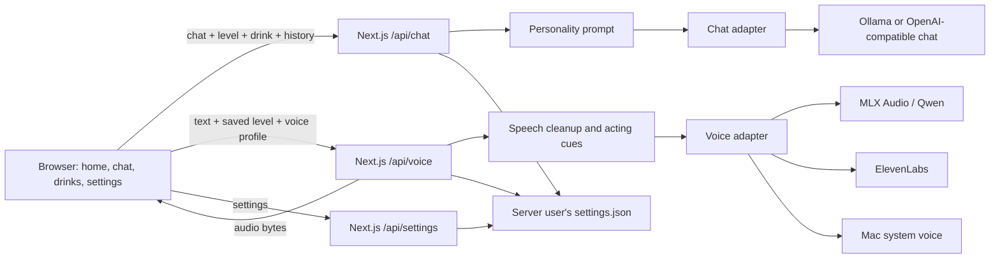

# MatalAI architecture

This document describes the current implementation, including its limitations. For installation and platform-specific instructions, see the [README](../README.md).

## Overview

MatalAI is a Next.js App Router application with a React interface and Node.js route handlers. It does not train a model. It combines an existing chat model, a fictional drink/personality system, and a separate voice provider. The default setup is designed for a single person running the app locally; it is not yet a secure multi-user hosted service.

The browser talks to the Next.js server; it does not call Ollama, MLX, or ElevenLabs directly. Provider credentials are read by the server. A provider can run on the same computer or at the configured server URL. ElevenLabs receives the spoken response text and voice cues when it is selected; a hosted chat provider receives the messages and system prompt.

## Routes and source layout

| Location | Responsibility |
| --- | --- |
| `src/app/page.tsx`, `src/app/chat/page.tsx` | Home page (`/`) and chat page (`/chat`). |
| `src/components/matal-app.tsx` | Current drink, virtual intoxication level, sobering timer, header, settings entry, and provider snapshot. |
| `src/components/chat-panel.tsx` | In-memory messages, request state, chat history sent to the server, and per-reply level/profile. |
| `src/components/response-audio.tsx` | Listen/Stop, audio request, in-page playback, temporary audio object URL, and error/fallback display. |
| `src/components/settings.tsx` | Local settings form, save and test controls. |
| `src/lib/engines/` | Drink calculation, prompt, acting-cue parsing, browser speech and local WAV effects. |
| `src/lib/providers/chat.ts`, `voice.ts`, `speech.ts` | Provider requests and Mac system speech generation. |
| `src/lib/config/settings.ts` | Server-side defaults, settings file I/O, key redaction and local-origin checks. |
| `src/app/api/` | Chat, voice, status, settings and connection-test HTTP endpoints. |

## What survives refresh?

| Information | Where it lives | Browser refresh / server restart |
| --- | --- | --- |
| Saved provider settings and keys | `settings.json` in the **server process user's home directory** | Survives as long as that file persists. |
| Unsaved settings edits | React state in the open dialog | Lost on refresh or closing the dialog. |
| Conversation, draft, reply levels and captured voice profiles | React state in the chat page | Lost on refresh, navigation away or new conversation. No database or conversation history is currently used. |
| Current tipsy level, selected drink and sobering timer | React state in the chat page | Reset on refresh/navigation: 0% tipsy, mocktail, no transition. |
| Generated reply audio | Browser memory and a temporary object URL while its message component is mounted | Lost on refresh/new conversation; the next Listen generates it again. |
| Server-side system-speech files | Temporary directory while `/usr/bin/say` generates a WAV | Removed after generation, including on failure where cleanup succeeds. |
| Rate-limit counters | Server process memory | Reset on server restart; not shared across server instances. |

Refresh reloads the settings form by fetching the server again. The settings are **not** saved in browser localStorage and are not tied to a browser tab. Two tabs connected to the same server use the same settings file, although a tab's UI state may remain stale until it reloads or saves again. A different server user, computer, container or deployment may have a different home directory and therefore different settings. On ephemeral hosting, the file can disappear on restart or redeployment.

## Settings and credentials

1. The gear opens `SettingsPanel`, which requests `GET /api/settings`. The server reads the file and merges it over defaults. The response includes `hasChatKey` / `hasVoiceKey` flags, not the key values.
2. Edits stay in component state until **Save settings** sends `POST /api/settings`. The server validates the provider choices, field lengths, and URLs, then writes a JSON file. A blank key field retains the existing key; the corresponding removal checkbox clears it. A supplied key replaces it.
3. Defaults are defined in `src/lib/config/settings.ts`. `OLLAMA_BASE_URL` and `OLLAMA_MODEL` can set the default Ollama values; saved settings override these defaults. When reading fails, the code uses defaults; this also means a malformed or unreadable file can appear as default settings.
4. On macOS/Linux, the path is `~/.matalai/settings.json`; on Windows it is `%USERPROFILE%\\.matalai\\settings.json` for the account running Node. The code requests directory mode `0700` and file mode `0600` when creating them. Windows uses its own ACL semantics; these mode values do not replace checking the Windows account's file permissions. Existing permissions are not necessarily repaired by a later write.
5. **Keys are stored as plaintext in this local file**, not encrypted or in a system keychain. Anyone or any process with access to the file can read them. The file is outside the repository, but a home-directory backup could include it. The API does not return the values to the settings UI. Do not commit, share, screenshot or paste the file or keys.
6. Settings read/write routes check the request's localhost hostname and same-origin signals. Settings are designed for localhost; the checks are not user authentication, access control for multiple people, encryption, or a complete public-host security boundary.

**Test saved chat/voice settings** uses the persisted settings, not unsaved form edits. The chat test checks the provider's model endpoint; it does not send a chat message. The voice test checks server/account reachability and, for ElevenLabs, attempts to list voices; it does not prove speech generation, model/voice access, credit availability or audio quality. The main status endpoint checks chat availability on page load; it is not a continuous health monitor.

## Drinks, sobriety and chat

- Drinks and their example ABV, serving size and personality flavor are in `drinks.ts`. A pour adds `round(ABV × servingMl / 100)` points, capped at 100. This is a fictional score, not a real intoxication calculation.
- Stage thresholds are 0, 15, 35, 60 and 85 points. The header shows `100 − rounded level` as the fictional sober percentage. The mood card shows the same state and the current tipsy percentage.
- **Sober up** switches the selected drink to mocktail and decreases the level from its starting value to zero over five seconds, updating roughly every 50 ms. Sending is disabled during this transition. Adding a drink cancels the transition and adds to the current level; Reset immediately sets the level to zero.
- When a message is submitted, `ChatPanel` captures the rounded current level, drink ID and selected voice snapshot. It sends up to 18 prior non-error messages plus the new user message to `/api/chat`. Once fully sober, prior assistant replies generated above zero are omitted from the model context, but remain visible in the chat. This reduces style carry-over; the model's behavior is probabilistic and user messages can still mention earlier drinks.
- The chat route validates the payload, constructs a new system prompt from that request's level and drink, and calls the configured chat adapter. Ollama uses `/api/chat`; OpenAI-compatible/OpenAI use `/chat/completions`. The response is returned as text. The selected chat provider and its credentials are read from current server settings when the request is handled.
- A request already sent continues with its captured level even if the meter or settings change while the model responds. The resulting reply keeps that level and the voice snapshot captured when the request was initiated. A new conversation aborts the active browser request and clears messages; it does not reset the drink meter.

## Voice generation and playback

Voice is generated only when Listen is clicked. The request contains the reply text, its saved level and, when available, its saved voice provider/presentation/profile. The server reads current settings for the provider's endpoint, model and credentials. Thus the snapshot preserves the chosen profile and provider, **not** an entire immutable configuration: changing a server URL, model or key can change or break an older uncached reply. The initial welcome message may not have a voice snapshot and uses the current server settings.

1. `/api/voice` validates input and rejects text with no speakable words. The speech engine removes emoji, translates the MatalAI name to a phonetic spelling, and recognizes a bounded set of acting notes. Visual cues are omitted; normal prose is preserved where possible.
2. The local MLX adapter posts to the configured `/audio/speech` endpoint with the selected model, profile, cleaned text and a level-specific instruction. Qwen gets cues as whole-utterance directions; it is not guaranteed to perform a cue or time it precisely. If the local server cannot be reached on macOS, the server generates a Mac system voice WAV and marks the response with `X-Voice-Fallback`. This fallback is not available on Windows.
3. ElevenLabs receives its voice ID, the selected level's inline delivery tag and recognized vocal tags such as laughter and hiccups. Its model may ignore or interpret tags differently. An HTTP 402 is reported as a credit/payment problem. Voice synthesis uses the provider's credits according to its terms.
4. The system voice provider calls macOS `/usr/bin/say` with a preset voice, creates PCM WAV audio, and applies level-scaled rate and tremolo effects. It is not equivalent to human acting and does not reliably perform nonverbal reactions. Browser speech code exists, but the current status route always supplies `voiceMode: local`; browser fallback is not exposed as a selectable setting.
5. The client keeps audio in a temporary object URL and plays it in a hidden audio element. Listen changes to a loading state then Stop. It attempts to stop prior audio and abort a pending request when a different response starts. Playback and generation can fail because of browser autoplay rules, provider availability, account quota, model behavior or output-device settings. Once audio has been generated, replay uses that cached audio until the component is removed.

## Security and deployment boundaries

The app is intended to run locally. `GET/POST /api/settings` and the settings-test endpoint use localhost/same-origin checks, but chat and voice routes are not authenticated. Outbound provider URLs come from saved settings, and the voice route accepts a provider/profile snapshot from the client. The limiter is a small in-memory per-process safeguard using request headers; it is not a distributed abuse or spending control. Content-length checks are not a substitute for infrastructure-level request limits. The settings file writes are not a database transaction and concurrent writes could overwrite changes. Provider errors are simplified and do not diagnose every failure.

For public hosting, add real authentication and per-user authorization, a secure secret store, reliable CSRF and outbound URL/SSRF protections, request-size limits, a shared rate limiter, spending limits and monitoring. Ensure the host can reach the chosen chat and voice servers; `127.0.0.1` refers to the server's own environment, not a visitor's laptop. Do not expose the MLX server directly without its own access controls.

## Verification and changes

Run `npm test`, `npm run format:check`, and `npm run build`. The tests cover provider request construction with simulated services, voice cue parsing, playback lifecycle and WAV processing; passing them does not prove a real provider's voice quality, availability or billing. Test the actual selected providers separately. MLX and ElevenLabs acting cues are best effort, not guaranteed sounds.
